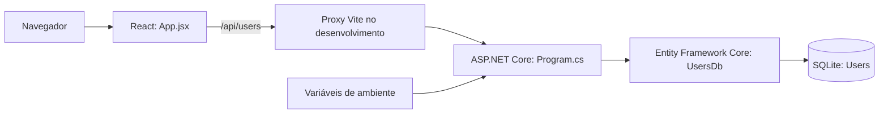

# UsuariosCrud — Software Design Document

| Campo | Valor |
| --- | --- |
| Projeto | ProMarket / UsuariosCrud |
| Data | 2026-10-23 |
| Código | `D:\promarket\UsuariosCrud` |
| Repositório | https://github.com/victorbosco-ti/teste-crud |
| Escopo | CRUD independente de usuários para testes locais |

## Contexto e decisão

Não existia SDD ou aplicação com esse nome no workspace. A solicitação foi implementar C# com React e conexão/credenciais por variáveis de ambiente. SQLite foi aceito explicitamente pelo usuário em substituição à sugestão inicial de H2. Este projeto não é extensão do cadastro de usuários do `hub-ia` e não acessa seus serviços ou bancos.

## Implementação

Em publicação, o ASP.NET Core serve o build React em `wwwroot` e os endpoints `/api` na mesma origem. No desenvolvimento, `frontend/vite.config.js` lê `API_PROXY_TARGET` para encaminhar essas requisições, sem incorporar o destino ao bundle. Nenhuma credencial é enviada ao navegador.

| Componente | Responsabilidade |
| --- | --- |
| `backend/Program.cs` | Inicialização, endpoints, modelo, validação e contexto EF Core |
| `backend/UsuariosCrud.Api.csproj` | .NET 8, EF Core SQLite e inclusão do build React no pacote publicado |
| `frontend/src/App.jsx` | Lista, busca, filtro, detalhes, formulários, confirmação e mensagens |
| `frontend/src/api.js` | Cliente HTTP relativo à origem atual e tradução de erros |
| `frontend/src/styles.css` | Layout responsivo sem dependência de fontes externas |
| `scripts/start-api.ps1` | Carrega `.env` e inicia a API, preservando variáveis do processo |

## Modelo e regras

Tabela `Users`: `Id` inteiro autoincremental; `Name` obrigatório (2–120 caracteres); `Email` obrigatório (até 254, validado); `IsActive` booleano; `CreatedAt` data UTC definida na criação. Validação de comprimento/formato ocorre na API. O índice único `IX_Users_Email` protege e-mails normalizados em concorrência.

Nome e e-mail têm espaços externos removidos. E-mail é armazenado com `ToLowerInvariant`. `PUT` substitui os campos editáveis e preserva ID/data; `isActive` omitido assume `true`. Exclusão é física. Status inativo não representa bloqueio de autenticação, pois este aplicativo não implementa login. Busca por nome/e-mail e filtro por status são feitos em memória no frontend após buscar a lista completa.

## Contrato HTTP

| Método/rota | Resposta normal | Erros esperados |
| --- | --- | --- |
| `GET /api/health` | 200 e `status: ok` | 503 se teste de conexão falhar |
| `GET /api/users` | 200, array ordenado por nome/ID | 500 genérico em falhas não tratadas |
| `GET /api/users/{id:int}` | 200, usuário | 404 |
| `POST /api/users` | 201, usuário e `Location` | 400 validação, 409 e-mail duplicado |
| `PUT /api/users/{id:int}` | 200, usuário atualizado | 400, 404, 409 |
| `DELETE /api/users/{id:int}` | 204, corpo vazio | 404 |

Entrada: `{ name, email, isActive }`. Saída de usuário: `{ id, name, email, isActive, createdAt }`. Validações usam Problem Details com `errors`; conflitos e ausências retornam `{ message }`. Endpoint desconhecido em `/api` retorna 404, mesmo quando o frontend está publicado. Logs usam console, sem depender do Event Log do Windows.

## Configuração e operação

- `ConnectionStrings__UsersDb` é lida diretamente do ambiente e obrigatória; não há fallback em código ou `appsettings`. SQLite local não utiliza credenciais de usuário/senha.
- `ASPNETCORE_URLS` define escuta e `ASPNETCORE_ENVIRONMENT` define o ambiente. Os exemplos usam loopback e mensagens genéricas de produção.
- `API_PROXY_TARGET` pertence somente ao servidor Vite. O browser usa `/api` relativo à própria origem.
- `.env` é carregado pelo script, não por `dotnet run`. O loader não sobrescreve variáveis já existentes nem avalia comandos do arquivo.
- `.env.example` contém apenas exemplos locais sem segredos. `.env`, bancos, dependências e artefatos são ignorados no `.gitignore`.
- Banco criado com `EnsureCreatedAsync`; não há migrations. O diretório do banco deve existir e permitir escrita. Caminho relativo é resolvido pelo diretório de execução.
- Frontend usa React 19 / Vite 6; API usa .NET 8 devido ao SDK disponível no workspace. Pacotes são fixados e há locks NuGet/npm.

## Validação e limites

`scripts/test-api.mjs` verifica contrato real por HTTP e SQLite persistente: validação, criação/normalização, concorrência de e-mail, edição, reinício, exclusão e configuração obrigatória. `frontend/tests/users.spec.js` verifica fluxo pelo navegador, duplicidade, cancelamento da exclusão, busca/filtro, layout móvel e recuperação de falha de rede. Bancos de teste são isolados em `.local`.

Na implementação de 23/10/2026, build da API (sem avisos/erros), build React, sete cenários HTTP e dois testes Playwright com Chrome passaram. As capturas desktop/móvel foram inspecionadas. O pacote de publicação também foi executado localmente, com respostas verificadas para HTML, JavaScript, health, listagem e 404 de endpoint desconhecido.

Não há autenticação, autorização, paginação, integração externa, migração de schema ou deploy externo. O estado implementado é um CRUD local; eventual publicação via HUB IA ou inclusão de autenticação seria trabalho adicional.

Guia de execução: [README](../README.md).

O repositório contém uma cópia deste SDD em `docs/SDD.md`, com links relativos próprios. Alterações de arquitetura ou contrato devem manter as duas versões alinhadas.
